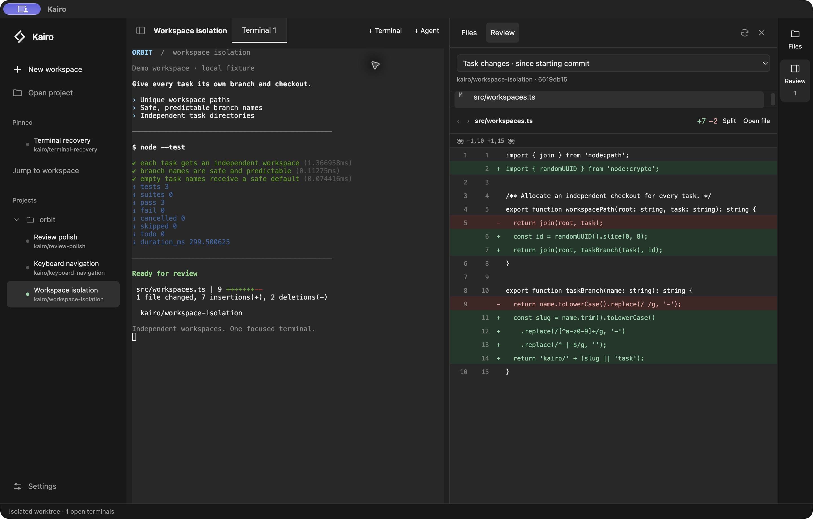

# Kairo



_Demo workspace showing local test output and Git review._

Kairo is a local desktop app for coding-agent terminals. Run Codex, Claude, OpenCode, Pi or another installed agent in a normal terminal, switch between tabs, and review Git changes beside your work. It is deliberately small: few controls, with rare actions kept in the command palette.

Kairo manages projects, task workspaces and terminal sessions. Each agent CLI owns its models, authentication, conversation and approvals. There is no built-in model engine, API-key settings page or automatic agent delegation.

## Built with

Kairo uses **TypeScript, React and Electron**, with a Node.js backend. Vite builds the desktop interface and backend, xterm renders terminals, node-pty runs interactive shells, and better-sqlite3 stores workspace and session metadata. Git operations use the installed Git CLI.

The desktop build compiles the TypeScript backend to JavaScript before launch. Node.js remains a runtime requirement; `KAIRO_NODE_EXECUTABLE` can select its executable.

## Run locally

Requirements: macOS, Git, Node.js 24.21+ and pnpm. Install an agent CLI to create agent sessions; plain terminals do not require one.

```sh
pnpm install
pnpm desktop:dev
```

For a production build and local preview:

```sh
pnpm desktop:build
pnpm desktop:preview
```

Kairo currently runs from source. Installers, signing and release distribution are not configured.

## Terminals and agents

1. Select **Open project** and choose a local folder.
2. Select **New workspace** for a separate task. Name the task and pick an agent (your last one is preselected); that is the whole form. Git projects get an isolated worktree by default and plain folders work without Git. Branch, starting ref, existing-worktree and project-folder choices are under **Advanced**.
3. Inside a workspace, use **+ Terminal** for a plain shell or **+ Agent** to choose an installed agent. Additional tabs share that workspace's files and Git state.
4. Select **Open agent terminal** for a stopped session. Kairo runs the CLI in an interactive shell.

The agent picker lists the agents it finds installed. **Add another agent…** shows the full 45-agent catalog from the referenced Orca catalog, with installation guides for missing ones. Install the CLI yourself and return to Kairo; the list updates when the window regains focus. Kairo does not install agents for you.

The sidebar groups named workspaces by project. Each workspace shows a status dot inferred from terminal output: pulsing green means output is flowing, amber means the terminal went quiet on an approval-style prompt ("Waiting for you"), and a ring means a terminal is open and idle. The same dot appears on a tab while it is working or waiting. This is a heuristic, not a signal from the agent; output right after your own keystrokes is treated as echo. Agent and plain-terminal tabs in the selected workspace share the center pane. Switching tabs keeps their processes running and preserves terminal screens and scrollback. Exit the agent to return to the same terminal's prompt. Ctrl+Z suspends a foreground agent; `fg` returns to it. The right sidebar contains **Files** and **Review**; there is no separate Shell panel.

## Projects and workspaces

A workspace owns its repository path, directory, branch and Git baseline. An agent session owns its selected CLI and conversation identity. Multiple agent sessions can work independently in separate worktrees. Additional agent tabs can share the selected workspace. Their terminals are independent, but their files and Git state are shared. Choose an isolated worktree for independent changes.

New worktrees start from committed files. Task names derive unique `kairo/<task>-<suffix>` branches, with an optional override. Choose a starting branch or commit from the searchable ref field. Kairo uses the saved project base, a locally known remote default, or the primary checkout's branch/`HEAD`. Missing saved bases require correction in **Project setup**. **Refresh remote refs** explicitly fetches; creation otherwise stays local.

The first time a project's new worktree would miss git-ignored `.env*` files, the dialog offers to copy them and remembers the choice. For a setup script or other ignored paths, run **Project setup** from the command palette (Cmd/Ctrl+J). Copies come from the primary checkout and belong independently to the new worktree. Tracked paths, symlinks, escapes, missing files and existing destination files are refused. Copying is bounded to 10,000 files / 256 MB; use scripts for larger preparation. Dependencies remain independently installed rather than symlinked.

Setup runs with `/bin/sh -e` in the new worktree, with `KAIRO_SOURCE_DIR` and `KAIRO_WORKSPACE_DIR` identifying both directories. Output retains its latest 32,000 characters. Scripts have a ten-minute limit and must finish; run development servers in ordinary terminal tabs. Setup scripts currently require macOS or Linux.

Creation continues in the background through checkout, copying and setup. Navigate elsewhere while it runs, or select its progress row to cancel. Failure/cancellation retains created files. **Retry preparation** uses the latest project settings and skips files already copied successfully; an optional agent starts only after preparation succeeds. Restart records interrupted preparation and offers recovery without automatically rerunning scripts.

New managed worktree paths end in the project's folder name, inside a task directory. Existing worktrees keep their locations. Worktrees remain ordinary Git checkouts usable from external tools. Selection, app focus and explicit refresh reconcile branch metadata and label missing directories unavailable without deleting history.

Workspaces and tabs have three verbs. **Close** (tabs) stops a terminal; closing an agent tab keeps its conversation identity and moves it to **Settings → Closed agent tabs**. **Archive** (workspaces) closes all its terminals and hides it while retaining files, branches and agent identities; restore it from **Settings → Workspaces**, or reopen its project folder and select **Restore workspace**. Restoration does not launch tabs. **Delete** (Kairo-managed worktrees) archives the workspace and removes its worktree folder; Git refuses removal while staged, unstaged, untracked or ignored files, or unmerged commits remain, and the branch is always preserved.

## Session management

Right-click a workspace row to rename, pin/unpin, archive or delete it. Right-click a project heading for New workspace. Shift+F10 opens the same menu from a focused row. The command palette (Cmd/Ctrl+J) lists the same workspace actions for the selected workspace, plus Project setup, Open project folder, Settings and theme. Workspace pins, names and last selected tabs persist in SQLite. Existing session pins migrate to workspace pins.

Right-click an agent tab to rename or close it; right-click a plain terminal tab to close it. Closing an agent tab stops its terminal and preserves its metadata, workspace and vendor-owned conversation history. Restore it from **Settings → Closed agent tabs**, where it can also be deleted; deleting session metadata does not delete workspace files or CLI history. Workspace archiving preserves individual session archive flags.

Session metadata persists in SQLite. Terminal processes stop when Kairo quits; the active agent session is reopened on startup. Codex and OpenCode conversation IDs are captured from their local metadata stores, matched to the workspace and launch time. Ambiguous matches are refused instead of choosing a global “last session.” When matching agents share a directory, Kairo preserves previously captured IDs but does not automatically assign new ones; use the CLI’s conversation picker for recovery. Exact recovery requires a saved conversation ID. Automatic identity capture is currently limited to Codex and OpenCode; other agents use their own history/resume controls and may require a new Kairo session after restart.

## Files and review

**Files** provides a lazy directory tree, filename search and a read-only text preview that refreshes on its own. Kairo has no built-in editor: **Open in Cursor** (macOS) opens a file, from Files or from a diff, in your editor. Binary files and files over 1 MB cannot be previewed.

**Review** lists changed paths and loads the selected diff in unified or split view. Task scope shows changes since the workspace's starting commit, including agent-created commits. Working-tree scope includes staged, unstaged and untracked changes. The visible panel refreshes independently of terminal output. File lists and diff rows are virtualized.

**Settings** is one page: appearance (system, dark or light), all workspaces (open, restore, delete), closed agent tabs, and a keyboard shortcut list.

## Keyboard shortcuts

| Shortcut           | Action                                     |
| ------------------ | ------------------------------------------ |
| Cmd/Ctrl+Shift+N   | New workspace                              |
| Cmd/Ctrl+J         | Jump to workspace or tab, or run a command |
| Cmd/Ctrl+P         | Quick open file                            |
| Cmd/Ctrl+backquote | New plain terminal tab                     |
| Cmd/Ctrl+Shift+E   | Files                                      |
| Cmd/Ctrl+Shift+D   | Review                                     |
| Cmd/Ctrl+Shift+B   | Toggle the project sidebar                 |

Escape inside a terminal is delivered to the CLI. Tab bars support arrow-key navigation. Dialogs contain focus and return it when closed.

## Data migration

This version replaces the former built-in model engine and protocol-based chat UI. The first opening of the terminal desktop database removes Kairo's legacy chat, task and evaluation records. Existing workspace/worktree records remain. Vendor-owned CLI conversations and credentials are unaffected.

## Development and verification

```sh
pnpm check
pnpm test
pnpm desktop:build
node scripts/desktop-smoke.mjs
```

The desktop smoke uses a fixture CLI in temporary Git workspaces. It checks terminal keyboard input, plain-terminal and agent tabs, working/waiting/idle status dots, the installed-first agent picker, project setup from the palette, the one-time `.env` copy offer, background isolated worktrees, independent ignored-file copies, workspace navigation, keyboard palettes and commands, diffs, mouse pin/unpin, workspace/session archives, the single settings page, restoration and exact conversation recovery after restart. It removes temporary state and checks that owned terminal processes stopped. `KAIRO_SMOKE_OUTPUT` selects the screenshot and metrics directory.

An additional **opt-in, experimental** smoke exercises installed, authenticated Codex and OpenCode:

```sh
node scripts/installed-agent-smoke.mjs
```

It sends small proof tasks to real agents and can consume provider usage. `KAIRO_NATIVE_CODEX_MODEL` and `KAIRO_NATIVE_OPENCODE_MODEL` override the test models without modifying CLI configuration; otherwise the CLIs use their configured models. `KAIRO_NATIVE_OUTPUT` selects the evidence directory. Native CLI trust, model availability and authentication can affect the run; a complete installed-agent workflow/restart pass is still pending verification.

`node scripts/desktop-benchmark.mjs` measures fresh launches and painted session switching with 24 workspace/session records and fixture CLI terminals. `KAIRO_BENCH_RUNS` controls sample count; `KAIRO_BENCH_OUTPUT` selects the report directory. Stage measurements separate Kairo-owned RSS from shells/agents, and include noisy output and three open/close recovery cycles. `KAIRO_BENCH_EMPTY=1` measures idle startup and memory. Shared pages may be counted repeatedly. Compare compatible terminal-desktop revisions only.

Implementation checkpoints and remaining verification are recorded in [the terminal desktop plan](docs/terminal-agent-desktop-plan.md). Orca-derived catalog metadata is attributed in [THIRD_PARTY_NOTICES.md](THIRD_PARTY_NOTICES.md).

The workspace-first delivery and benchmark methodology are recorded in [the workspace workflow checkpoint](docs/workspace-workflow.md). The current TypeScript/Electron optimizations and measured limits are recorded in [the resource checkpoint](docs/lightweight-electron.md).

The recorded five-run M2/macOS comparison measured a 47.2% reduction in renderer build bytes, with Kairo-owned median RSS decreasing from 479.3 to 443.2 MiB at idle and from 551.5 to 518.9 MiB with eleven terminals. These are fixture measurements on one machine; renderer bytes exclude Electron and backend dependencies. Kairo still ships an Electron interface, and a packaged application size has not been measured. See the resource checkpoint for methodology, startup and switching results, and full reports.
